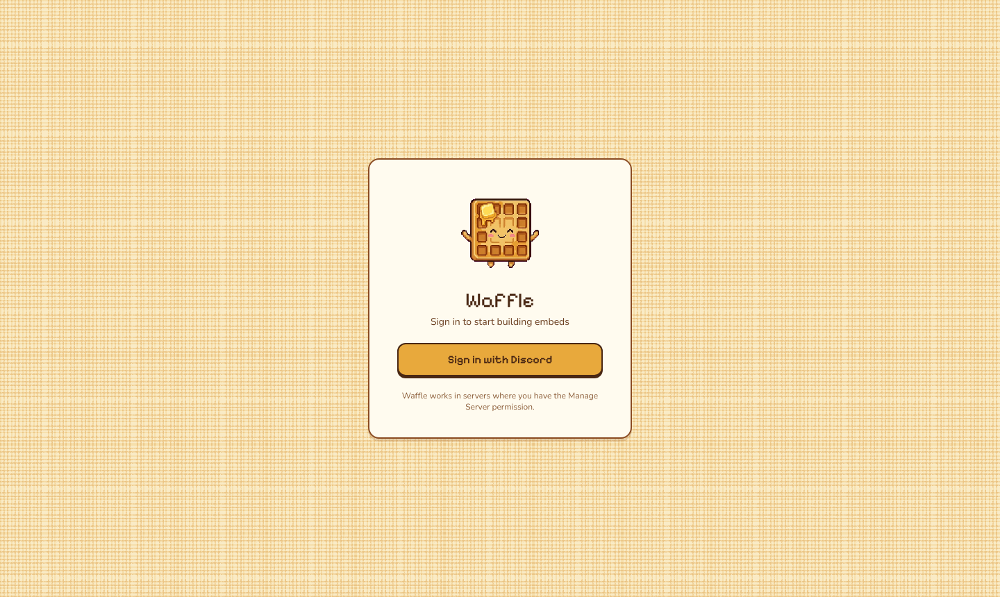
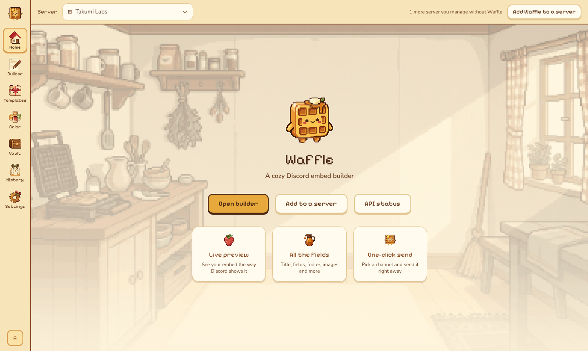
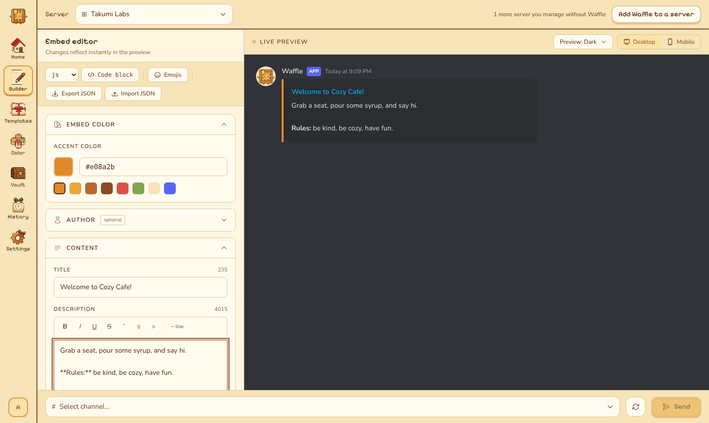
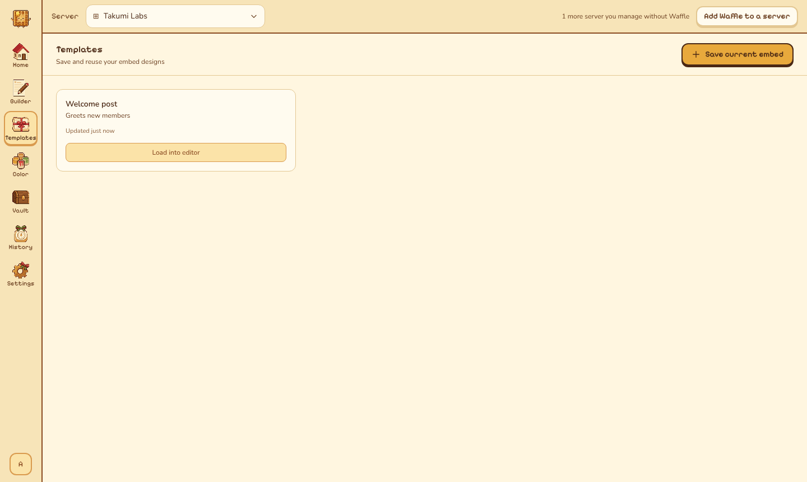
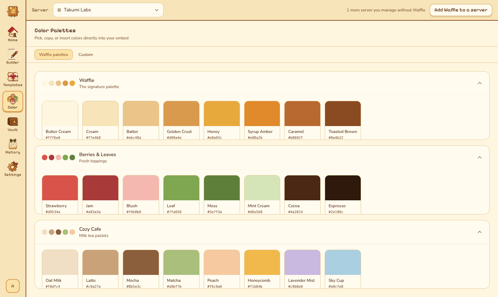
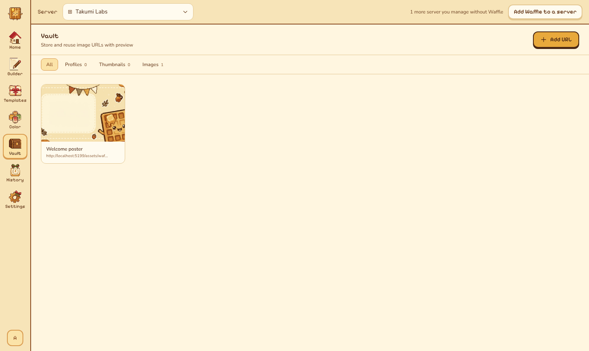
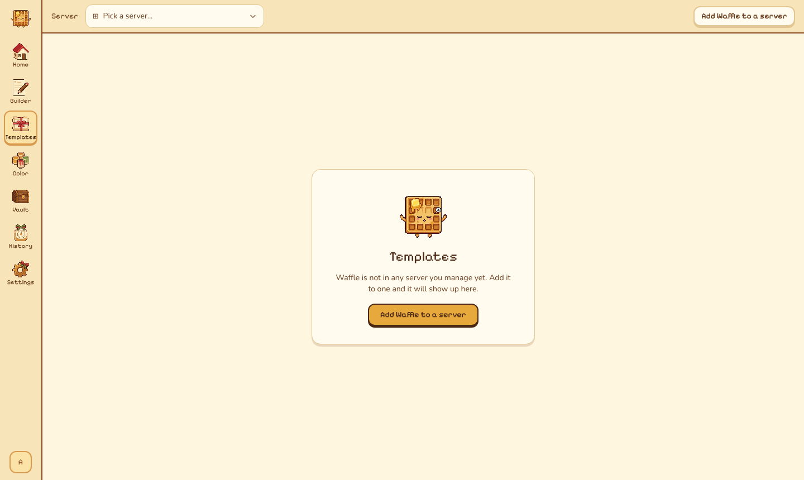
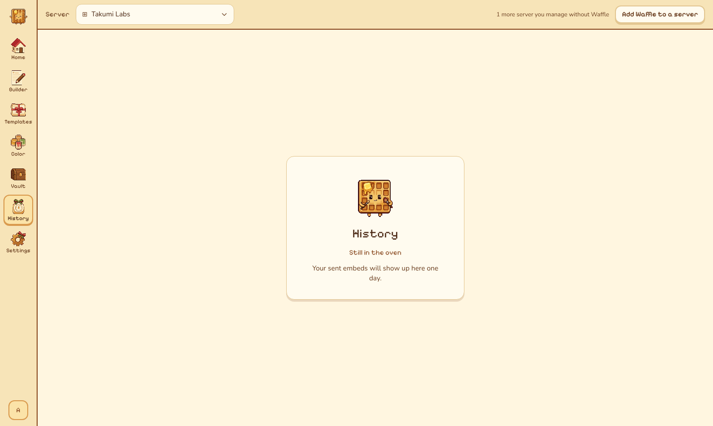
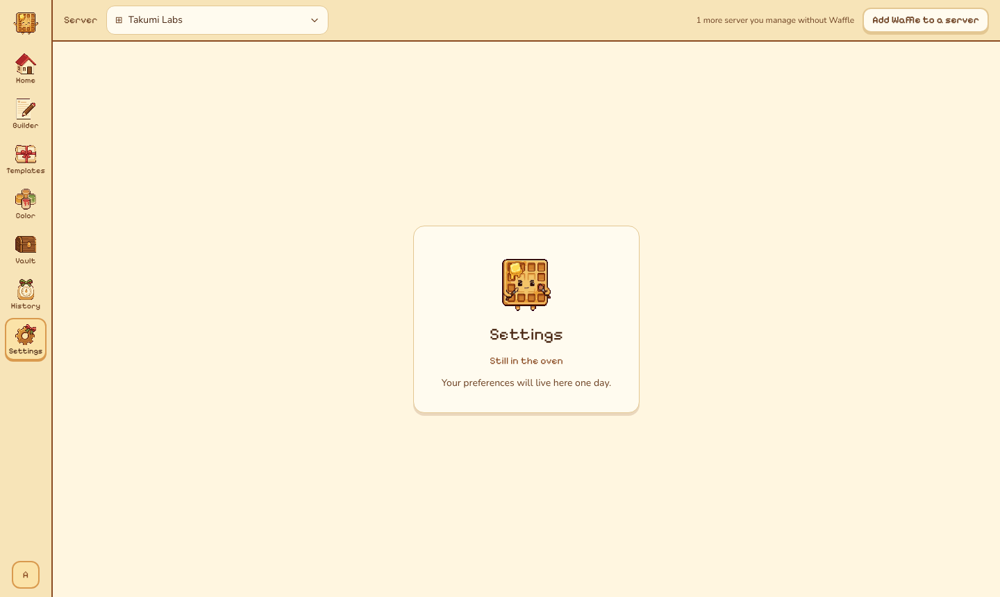

<div align="center">


# Waffle

### A cozy Discord embed builder

*Build. Preview. Send.*

---


</div>

---

## ✦ Overview

Waffle is a Discord embed builder with a live web dashboard and a cozy pixel-art look. Design rich embeds visually, preview them in a Discord-style replica, and send them straight to a channel, all without writing code.

Waffle works in **any server**. Anyone can sign in with Discord, and for each server they can use Waffle only if they own it or have the **Manage Server** (or Administrator) permission there. Waffle checks this with Discord on every request, not just at sign-in. Templates and the Vault are saved per server.

> Waffle was previously called Inari. Your old `inari.db` is copied to `waffle.db` automatically on first start (the old file is never deleted).

---

## ✦ Features

- **Discord OAuth2 sign-in**, with access decided per server (Manage Server or higher)
- **Multi-server**: pick the server at the top, or add Waffle to a new one with one click
- **Live preview** with Dark, Light and AMOLED Discord themes
- **Full embed control**: title, description, author, footer, fields, thumbnail, image, color, timestamp
- **Code block inserter** with a language picker
- **Emoji picker** that loads your real server emojis (animated ones too)
- **JSON import / export** for any Discord embed
- **Templates**: save named embed presets per server and reload them in one click
- **Vault**: keep image URLs per server with live previews (Profiles, Thumbnails, Images)
- **Color palettes**: Waffle, Berries & Leaves, Cozy Cafe, plus a custom picker
- **Desktop / mobile preview** toggle
- **Direct send**: choose the server and channel, then send
- **Persistent storage** in SQLite (templates and vault survive restarts)
- **Coming soon**: History and Settings pages

---

## ✦ Screenshots

*Screenshots show sample data.*

### Sign in


### Home


### Builder
Edit on the left, see the Discord-style preview on the right, then pick a channel and send.


### Templates
Save named embed designs per server and load them back in one click.


### Color palettes


### Vault
Keep image URLs per server with live previews.


### When Waffle isn't in a server yet


### History and Settings (coming soon)
 

---

## ✦ Tech Stack

| Layer     | Tool                       |
| --------- | -------------------------- |
| Runtime   | Node.js 24 LTS             |
| Bot / API | Discord.js v14 + Express 5 |
| Dashboard | React 19 + Vite 8          |
| Styling   | Tailwind CSS v4            |
| Storage   | SQLite (better-sqlite3)    |
| Auth      | Passport + Discord OAuth2  |
| Hosting   | Docker (one image)         |
| Desktop   | Electron                   |

Fonts: [Pixelify Sans](https://fonts.google.com/specimen/Pixelify+Sans) (headings and buttons) and [Nunito](https://fonts.google.com/specimen/Nunito) (body), both loaded from Google Fonts.

---

## ✦ Setup

### Prerequisites

- Node.js 24 (LTS) and Git
- Docker Desktop (optional, only for the Docker route)
- A Discord application with a bot token and OAuth2 enabled

### 1. Clone and create your `.env`

```bash
git clone https://github.com/Takumi-Labs-Dev/Inari.git
cd Inari
cp .env.example .env      # on Windows PowerShell: Copy-Item .env.example .env
```

Open `.env` and fill in every `your_..._here` value. `.env.example` explains each one.

### 2. Add the OAuth2 redirect in the Discord Developer Portal

Your application → OAuth2 → Redirects → add exactly the value of `REDIRECT_URI`, for example:

```
http://localhost:3003/auth/callback
```

### 3. Run with Node (no Docker)

```bash
cd dashboard
npm install
npm run build
cd ../bot
npm install
npm start
```

Open http://localhost:3003 and click **Sign in with Discord**. Then use **Add Waffle to a server** (top right) to invite the bot to a server you manage, and pick that server in the bar at the top.

The invite only asks for the permissions Waffle needs: View Channel, Send Messages and Embed Links.

### 3b. Or run with Docker

```bash
docker compose up --build -d
```

One image holds the bot and the dashboard (the dashboard is built inside the image, so you do not need to run `npm run build` first). Open http://localhost:3003. Your data lives in `bot/data` and survives rebuilds. Stop any `node src/index.js` run first, because both use port 3003.

```bash
docker ps                 # STATUS should say (healthy)
docker compose logs -f    # watch the bot
docker compose down       # stop
```

### Hosting settings (when you put Waffle on a public address)

- Set `REDIRECT_URI` in `.env` to your public https address (for example `https://waffle.example.com/auth/callback`) and add the same address in the Discord Developer Portal under OAuth2 > Redirects.
- Secure cookies and proxy trust are then switched on automatically. `COOKIE_SECURE` and `TRUST_PROXY` only exist to override that.
- Set `ALLOWED_ORIGINS` to the public site address.
- Sign-ins are saved (encrypted) in `bot/data/waffle.db`, so people stay signed in across restarts. Changing `SESSION_SECRET` signs everyone out.
- Built in: rate limits, security headers (CSP, HSTS on https) and per-person sending limits.

### Desktop app (Electron)

```bash
cd dashboard
npm run electron:dev      # development: starts Vite and opens the window
npm run electron:build    # builds the Windows installer into dashboard/release
```

The packaged app is a window onto your Waffle site. The address is in `dashboard/waffle-app.json` (default `http://localhost:3003`). Change it to your public address before running `npm run electron:build` and the installer opens that site instead. The site must be running first.

---

## ✦ Project Structure

```text
├── bot/                  # Discord bot + REST API
│   ├── src/
│   │   ├── index.js      # Entry point
│   │   ├── access.js     # Which servers a person may manage (asks Discord)
│   │   ├── env.js        # .env loading and checks
│   │   ├── client.js     # Discord client
│   │   ├── db.js         # SQLite setup (waffle.db) and upgrades
│   │   └── routes/
│   │       ├── api.js    # Express API + dashboard static files
│   │       └── auth.js   # Discord OAuth2 + session
│
├── dashboard/            # React dashboard
│   ├── public/assets/    # Pixel-art assets (waffle/...) and icon.ico
│   ├── src/              # components, pages, store, api client
│   ├── waffle-app.json   # Address the desktop app opens
│   └── electron.cjs      # Electron main process
│
├── Dockerfile            # One image: bot + dashboard
├── docker-compose.yml
└── .env
```

---

## ✦ Version

**Current Version:** `0.1.0-beta`

---

## ✦ License

Private. All rights reserved © Takumi Labs
